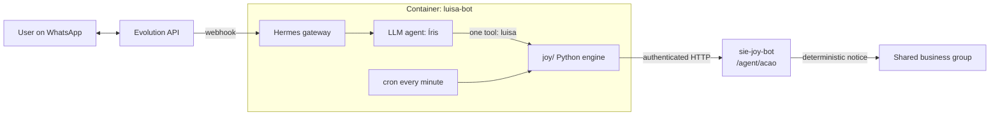

<div align="center">

# 🌸 Íris: a private WhatsApp assistant with a privacy-aware bridge

### Personal assistant agent with reminders, tasks and an audited link to a second agent

*A one-person assistant that keeps one business's data strictly private while being able to act on a shared one, with the shared side notified deterministically (not by the LLM).*


</div>

---

## What is it?

**Íris** is a personal WhatsApp assistant for one user. It answers everything in a private group (user + bot only) and in direct
messages, and stays silent anywhere else. It manages **reminders**, a **task ledger**, a short **onboarding profile**, and it is
wired to a *second* agent, [sie-joy-bot](https://github.com/pjaragao/sie-joy-bot), that runs a shared business.

The interesting part is the **trust boundary** between the two agents.

## 🔐 Design: privacy and auditability between agents

| Rule | How it is enforced |
|---|---|
| The user's **private business data is never shared** with the other agent or its human | Prompt rule + a profile store where the user records exactly what may be shared (`perfil_salvar`) |
| The user can **read and act on the shared business** | `consulta=sie` calls the other agent through an authenticated HTTP link (`joy/link.py`) |
| **Every action that changes the shared business is announced** to that business's group | The *other* agent exposes an `/agent/acao` endpoint that performs the change **and posts the notice itself**. The notice does not depend on the LLM remembering to do it |
| Nothing is "done" without evidence | Task ledger marks items *effected* only with a quoted confirmation |
| No credentials in chat | If a secret is pasted the bot refuses to repeat it and suggests a password manager |

## 💬 How it behaves

The user asks for a weekly reminder (created and confirmed with the schedule), registers a task, or asks whether a supplier was
already paid. Íris queries the shared business through the link (read-only, so no notice is needed) and answers with the booked
entry. Any change to the shared business goes through the other agent, which announces it in that group.

## ✨ Features

- ⏰ **Reminders**: one-off, daily, weekly and monthly, delivered by a once-a-minute cron (`joy/lembretes.py`).
- ✅ **Task ledger**: `tarefa_registrar`, `tarefa_listar`, `tarefa_atualizar` with evidence-based completion.
- 🙋 **Profile and onboarding**: a questionnaire fills the preferences store (`joy/perfil.py`), then it keeps learning from usage.
- 🔗 **Agent-to-agent link**: read/act on the shared business with automatic notification (`joy/link.py`).
- 📄 **Documents, voice, images**: PDF/image/audio reading through the model's vision and transcription (`joy/documentos.py`).
- 🔎 **Web and product research** with direct links only.
- 🧵 **Reply-chain context** and an append-only chat history.

## 🏗️ Architecture



## 📁 Layout

| Path | What |
|---|---|
| `joy/core.py` | query router for the `luisa` tool |
| `joy/link.py` | bridge to the other agent |
| `joy/lembretes.py`, `joy/pendencias.py`, `joy/perfil.py` | reminders, task ledger, profile |
| `joy/documentos.py`, `joy/pesquisa.py`, `joy/group_history.py`, `joy/reply_chain.py` | input handling and research |
| `docker-compose.yml` · `data/config.yaml` · `data/.env.example` | deployment |

## 🚀 Run it

Needs Docker, an [Evolution API](https://github.com/EvolutionAPI/evolution-api) instance, an OpenAI-compatible LLM endpoint,
the [Hermes Agent](https://hub.docker.com/r/nousresearch/hermes-agent) image and a running `sie-joy-bot` for the link.

```bash
git clone https://github.com/pjaragao/luisa-bot.git && cd luisa-bot
cp data/.env.example data/.env      # Evolution, model, SIE_LINK_URL / SIE_LINK_TOKEN
docker compose up -d
```

> The persona prompt, profile data and all credentials are intentionally **not** in this repository.

---

<div align="center">

Built by **Paulo Aragão Jr** · [GitHub](https://github.com/pjaragao) · related: [sie-joy-bot](https://github.com/pjaragao/sie-joy-bot) · [lolo-bot](https://github.com/pjaragao/lolo-bot) · [mr-irrelevant](https://github.com/pjaragao/mr-irrelevant)

</div>
